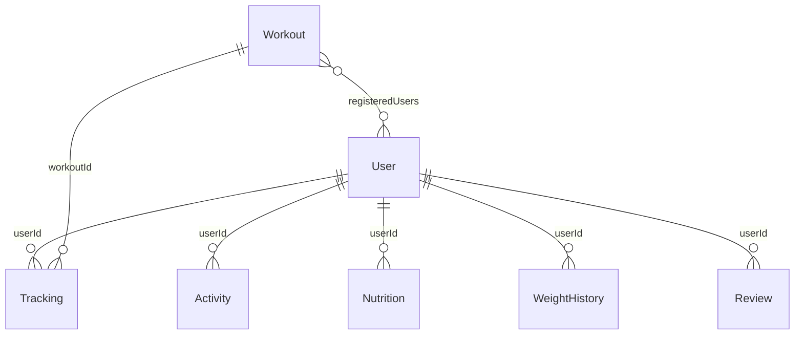

<div dir="rtl">

# VitaliFit - צד שרת (API)

שרת Node.js + Express לאתר VitaliFit: ניהול משתמשים והרשאות, לוח אימונים, מעקב פעילות ומשקל, תזונה עם ניתוח תמונות באמצעות AI (Gemini), המלצות ופניות. הנתונים נשמרים ב-MongoDB Atlas.

## טכנולוגיות

Node.js (ES Modules), Express 5, MongoDB + Mongoose, JWT (הרשאות), bcrypt (הצפנת סיסמאות), Joi (ולידציה), multer (העלאת קבצים), Google Gemini (ניתוח ארוחות), dotenv, cors.

## הרצה מקומית

1. מעתיקים את `.env.example` מתיקיית השורש ל-`server/.env` ומגדירים את הערכים.
2. מתקינים ומריצים:

```bash
cd server
npm install
npm run dev
```

3. בדיקה שהשרת עובד: `http://localhost:5000/api/status`.
4. בדיקת עשן אוטומטית (השרת צריך להיות דלוק): `npm run smoke`.

### משתני סביבה (`.env`)

| משתנה | חובה | תיאור |
|---|---|---|
| `MONGO_URI` | כן | כתובת החיבור ל-MongoDB Atlas. בלעדיה השרת לא עולה |
| `JWT_SECRET` | כן | מפתח סודי לחתימת טוקנים. בלעדיו השרת לא עולה |
| `CLIENT_URL` | כן | Origin של לקוח האינטרנט; אפשר כמה Origins מופרדים בפסיקים |
| `SHABBAT_BLOCKING_ENABLED` | לא | `false` מבטל את חסימת השבת; ברירת המחדל היא חסימה |
| `GEMINI_API_KEY` | לניתוח ארוחות | מפתח ל-Gemini |
| `PORT` | לא | פורט (ברירת מחדל 5000) |
| `NODE_ENV` | לא | `development` מציג stack; `production` כותב שגיאות ל-`server/logs/error.log` |

## מבנה התיקיות

```
server/
├── server.js              נקודת הכניסה: middlewares, routes, חיבור ל-DB
├── constants/             ערכים קבועים (תפקידים, סוגי פעילות, קטגוריות)
├── models/                סכמות Mongoose
├── routes/                הגדרת נתיבים וה-middlewares של כל נתיב
├── controllers/           הלוגיקה של כל נתיב
├── middlewares/
│   ├── auth.middleware.js       verifyToken (JWT) ו-isAdmin
│   ├── validate.middleware.js   middleware אחד לכל הוולידציות (Joi)
│   ├── validators/              סכמות Joi
│   ├── upload.middleware.js     העלאת תמונות (multer)
│   ├── custom.middleware.js     middleware מותאם: חסימת ימים (שבת)
│   └── error.middleware.js      טיפול מרוכז בשגיאות
├── services/              התחברות ל-Gemini
├── utils/                 פונקציות עזר וטוקנים
├── scripts/smoke-test.mjs בדיקת עשן
└── uploads/               תמונות שהועלו (לא נשמר ב-Git)
```

## משתמשים והרשאות

שני סוגי משתמשים: `user` (ברירת מחדל בהרשמה) ו-`admin`. הטוקן (JWT) כולל את ה-`userId` ואת ה-`role`. השרת בודק הרשאות ב-`verifyToken` וב-`isAdmin`, והלקוח מציג תפריט שונה לפי ה-`role` שחזר בהתחברות.

## נתיבי ה-API

הנתיבים מסומנים לפי הרשאה: **פתוח** (בלי התחברות), **משתמש** (טוקן), **מנהל** (טוקן של admin).

| דרישה | Method | URL | הרשאה | גוף הבקשה |
|---|---|---|---|---|
| בדיקת שרת | GET | `/api/status` | פתוח | - |
| הרשמה | POST | `/api/auth/register` | פתוח | `fullName`, `email`, `password` |
| התחברות | POST | `/api/auth/login` | פתוח | `email`, `password` |
| פרופיל | GET | `/api/auth/profile` | משתמש | - |
| רשימת אימונים (עם סינון) | GET | `/api/workouts?search=&category=&type=` | פתוח | - |
| הוספת אימון | POST | `/api/workouts` | מנהל | `title`, `description`, `date`, `time`, `instructor`, `maxParticipants`, `durationMinutes`, `estimatedCalories`, `type`, `category` |
| עריכת אימון | PUT | `/api/workouts/:id` | מנהל | כמו בהוספה |
| מחיקת אימון | DELETE | `/api/workouts/:id` | מנהל | - |
| הרשמה לאימון | POST | `/api/workouts/:id/register` | משתמש | - |
| סימון אימון כהושלם | POST | `/api/tracking/:workoutId/complete` | משתמש | - |
| לוח מעקב | GET | `/api/tracking` | משתמש | - |
| הוספת פעילות עצמאית | POST | `/api/activities` | משתמש | `activityType`, `durationMinutes`, `date` (אופציונלי) |
| רשימת פעילויות | GET | `/api/activities` | משתמש | - |
| עדכון משקל | POST | `/api/weight` | משתמש | `weight` |
| היסטוריית משקל | GET | `/api/weight/history` | משתמש | - |
| ניתוח ארוחה לפי תמונה | POST | `/api/nutrition/analyze` | משתמש | `multipart/form-data`: `mealName`, `date`, `image` |
| היסטוריית ארוחות | GET | `/api/nutrition` | משתמש | - |
| המלצות מאושרות | GET | `/api/reviews/approved` | פתוח | - |
| הוספת המלצה | POST | `/api/reviews` | משתמש | `text`, `name`, `isAnonymous` |
| כל ההמלצות | GET | `/api/reviews/admin/all` | מנהל | - |
| אישור / דחיית המלצה | PUT | `/api/reviews/admin/:id/status` | מנהל | `status` |
| שליחת פנייה | POST | `/api/contact` | פתוח | `name`, `email`, `subject`, `message` |
| כל הפניות | GET | `/api/contact/admin/all` | מנהל | - |
| רשימת משתמשים | GET | `/api/admin/users` | מנהל | - |
| מחיקת משתמש | DELETE | `/api/admin/users/:id` | מנהל | - |
| שינוי תפקיד | PATCH | `/api/admin/users/:id/role` | מנהל | `role` |

שגיאות חוזרות בפורמט אחיד: `{ "success": false, "status": 400, "message": "..." }`.
שגיאות צפויות נוצרות כ-`AppError` ומועברות למטפל השגיאות המרכזי; Express 5
מעביר אליו אוטומטית שגיאות מ-Promise של בקרות async. בפיתוח השגיאות נרשמות
לקונסול, וב-production לקובץ `logs/error.log`.

## מסד הנתונים



| אוסף | שדות עיקריים | קשרים |
|---|---|---|
| `User` | fullName, email (ייחודי), password (מוצפנת), role, weight | - |
| `Workout` | title, description, date, time, instructor, maxParticipants, durationMinutes, estimatedCalories, type, category | `registeredUsers` - מערך הפניות ל-User (הרשמה לאימון) |
| `Tracking` | completedAt, durationMinutes, caloriesBurned | `userId` ל-User, `workoutId` ל-Workout |
| `Activity` | activityType, durationMinutes, caloriesBurned, date | `userId` ל-User |
| `WeightHistory` | weight, date | `userId` ל-User |
| `Nutrition` | mealName, calories, protein, carbs, fats, date, imageUrl | `userId` ל-User |
| `Review` | name, text, status (pending / approved / rejected) | `userId` ל-User |
| `ContactMessage` | name, email, subject, message, status | - |

בשמירת משתמש רץ hook מסוג `pre('save')` שמצפין את הסיסמה עם bcrypt, וב-`toJSON` הסיסמה מוסרת מכל תשובה. סוגי המדיה באתר: טקסט (תכנים, שמות, תיאורים) ותמונות (תמונות ארוחה).
מחיקת משתמש מפעילה hook של Mongoose שמוחק את נתוני הפעילות, התזונה, המעקב,
המשקל וההמלצות שלו, ומסיר אותו מרשימות הנרשמים לאימונים.

## Middlewares

- **`validate(schema, source)`** - middleware אחד לכל הוולידציות. מקבל סכמת Joi ובודק את `body` או `params`, מנקה רווחים ושדות לא מוכרים, ומחזיר 400 עם הודעה בעברית.
- **`verifyToken` / `isAdmin`** - אימות JWT והרשאת מנהל.
- **`createDayBlocker([6])`** (מותאם אישית) - חוסם את ממשקי ה-API בשבת לפי `Asia/Jerusalem`; `/api/status` נשאר זמין. ניתן לבטל את כל חסימות השבת באמצעות `SHABBAT_BLOCKING_ENABLED=false`.
- **CORS** - מאפשר רק Origins המוגדרים ב-`CLIENT_URL`.
- **`upload`** - העלאת תמונות בלבד (JPG, PNG, WEBP) עד 5MB, לתיקיית `uploads`.
- **`errorHandler`** - מטפל מרוכז בכל השגיאות (multer, Mongoose, מזהה לא תקין, ערך כפול).

## העלאה ל-Render

1. מעלים את הפרויקט ל-GitHub.
2. ב-Render יוצרים **Web Service** מהריפו, עם **Root Directory** = `server`, **Build Command** = `npm install`, **Start Command** = `npm start`.
3. מגדירים ב-Environment את `MONGO_URI`, `JWT_SECRET`, `CLIENT_URL` ו-`NODE_ENV=production`;
   מוסיפים `GEMINI_API_KEY` אם נדרשת אנליזת ארוחות.
4. ב-MongoDB Atlas, תחת Network Access, מאשרים גישה מהשרת (`0.0.0.0/0`).
5. אחרי שהשרת עלה, מעדכנים את כתובת השרת בקובץ ההגדרות של הלקוח, עושים קומיט, ורק אז מעלים את הלקוח.

שימו לב: הדיסק ב-Render זמני, ולכן תמונות שהועלו נמחקות בהפעלה מחדש של השרת.

</div>